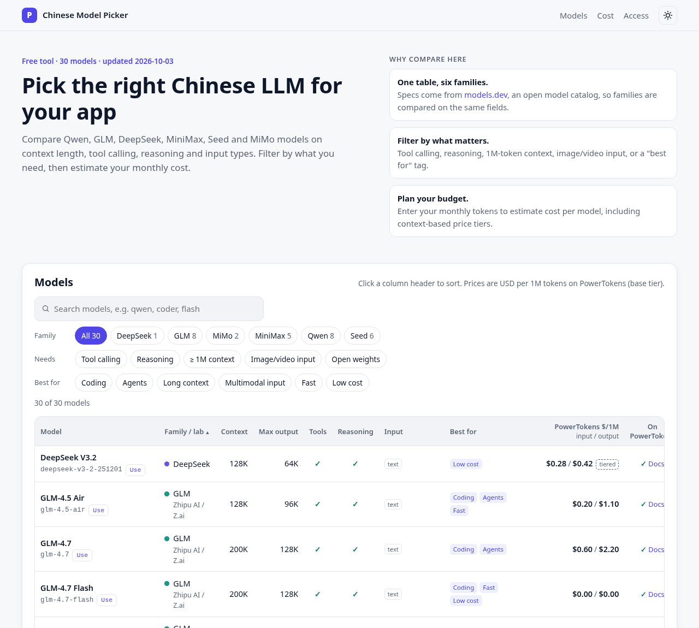

# Chinese Model Picker

Pick the right Chinese AI model (GLM, Qwen, MiniMax, Seed, MiMo, DeepSeek): specs, [PowerTokens](https://powertokens.ai/?utm_source=github&utm_medium=tool&utm_campaign=model-compare) pricing and a cost calculator.

**Live site: https://powertokens.github.io/chinese-model-picker/**

[](https://powertokens.github.io/chinese-model-picker/)

One sortable table compares context length, max output, tool calling, reasoning, input types and price per 1M tokens, with filters for what you need and a monthly cost estimator. Static HTML/CSS/JS, no build step, served by GitHub Pages.

## Run locally

```bash
python3 -m http.server 8765
# open http://localhost:8765/
```

## Refresh the data

```bash
python3 scripts/fetch_prices.py                               # uses a local models.dev clone if MODELS_DEV_DIR / --models-dev is set,
python3 scripts/fetch_prices.py --models-dev ../models.dev    # otherwise fetches lab files from GitHub raw
```

Writes `data/models.json`. Python 3.11+, standard library only, no API keys. A weekly GitHub Action (`.github/workflows/refresh-data.yml`) runs the same script and commits `data/models.json` when models or prices change.

## Data sources

| Field | Source |
|---|---|
| Model list | Text models in [docs.powertokens.ai/llms.txt](https://docs.powertokens.ai/llms.txt?utm_source=github&utm_medium=tool&utm_campaign=model-compare) that also have a published price |
| Price (USD / 1M tokens, incl. prompt-length tiers) | [powertokens.ai/pricing](https://powertokens.ai/pricing?utm_source=github&utm_medium=tool&utm_campaign=model-compare) (public endpoint `POST /api/model/pricing`) |
| Context, max output, tool calling, reasoning, input modalities, open weights, description | [models.dev](https://github.com/anomalyco/models.dev) lab files `models/<lab>/<model>.toml` |
| "Best for" tags | Derived in `scripts/fetch_prices.py` from the fields above (see the Method section on the page) |

Specs are the lab's model specs; what a given API exposes can differ. Prices change; verify on the official pages.

## FAQ

**Which Chinese AI model is best for coding?**  
No single model is best for every codebase. In this table, the models whose models.dev descriptions mention coding include Qwen3 Coder Plus, Qwen3 Max and the Qwen3.7 and Qwen3.8 Plus/Max models, GLM-4.5 Air, GLM-4.7 and the GLM-5.x series, MiniMax M2.5, M2.7 and M3, and Xiaomi MiMo-V2.5 and V2.5-Pro. Use the *Coding* filter to compare their context length, tool calling and price, then test the shortlist on your own code.

**How do I use Qwen or GLM outside China?**  
Qwen is available internationally through Alibaba Cloud Model Studio and GLM through Z.ai; the mainland sites (Bailian, BigModel) may require a Chinese phone number, real-name verification or local payment. You can also call both through an OpenAI-compatible gateway such as PowerTokens, which serves every model in this table from `https://api.powertokens.ai/v1`.

**Is there one API key for GLM, Qwen, MiniMax and DeepSeek V3.2?**  
Yes. A PowerTokens API key works for all models listed here, including GLM, Qwen, MiniMax, DeepSeek V3.2, ByteDance Seed and Xiaomi MiMo, and you switch models by changing the `model` string. On the official platforms each lab is a separate account, key and balance.

**How much does it cost to use these models?**  
You pay per token, priced in USD per 1M input and output tokens, and some models charge a higher rate for long prompts. Enter your monthly token volume in the [cost calculator](https://powertokens.github.io/chinese-model-picker/#calculator) to estimate the cost per model, and check [powertokens.ai/pricing](https://powertokens.ai/pricing?utm_source=github&utm_medium=tool&utm_campaign=model-compare) for current rates.

**Are these models OpenAI-compatible?**  
Through PowerTokens, yes: every model here uses the OpenAI Chat Completions format, so the official OpenAI Python or Node SDK works with `base_url` set to `https://api.powertokens.ai/v1`. Click *Use* on any row to get a ready-to-run snippet.

**Where do the specs and prices come from?**  
Context length, max output, tool calling, reasoning and input types come from the open [models.dev](https://github.com/anomalyco/models.dev) catalog, and prices come from the PowerTokens pricing page. Both are regenerated into `data/models.json` by `scripts/fetch_prices.py`; the check date is shown in the footer.

## Screenshots

`scripts/screenshots.py` (Playwright) writes review PNGs to `screenshots/` (not committed).

## License

[MIT](LICENSE). Model names and trademarks belong to their owners.

Created by [@uselesssoso](https://github.com/uselesssoso) for [PowerTokens](https://powertokens.ai/?utm_source=github&utm_medium=tool&utm_campaign=model-compare).
